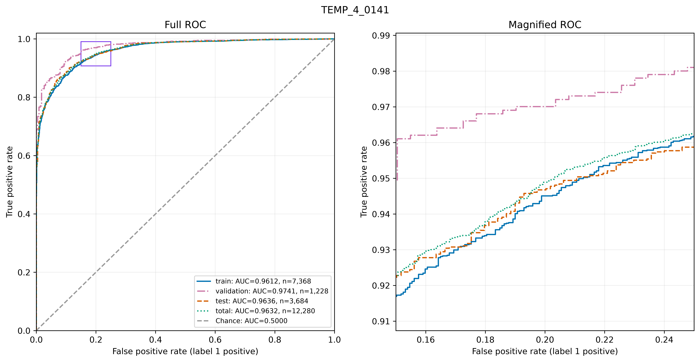
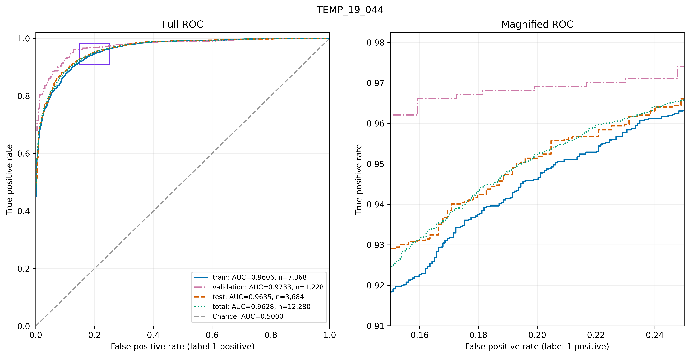

# PySR in Extended Higgs Sector Models

Symbolic regression for a two-mass classification problem in an extended Higgs model. PySR learns an explicit score from the neutral mass $m_{\chi_1}$ and charged mass $m_{\chi_1^\pm}$, expressed in GeV, to distinguish the dataset's binary reference labels.

## How to run this on your machine

1. Clone the repository and enter its directory:
   ```bash
   git clone https://github.com/wadewolfie999/pysr_ext_higgs.git
   cd pysr_ext_higgs
   ```

2. Check Python; the environment used for this project is Python `3.13.7`:
   ```bash
   python --version
   ```
   If needed, install pyenv with `curl -fsSL https://pyenv.run | bash`, follow its shell setup instructions, and restart your terminal. Then select Python:
   ```bash
   pyenv install 3.13.7
   pyenv local 3.13.7
   ```

3. Julia setup differs by platform. The project owner reports that their Linux environment required Julia `1.11.9`. On macOS, running Python code that uses `PySRRegressor` installed and initialized a working Julia environment through PySR; its exact version is not pinned here. For the Ubuntu Snap route, inspect the available channels and confirm the desired version before installing:
   ```bash
   snap info julia
   sudo snap install julia --classic --channel=lts/stable
   ```

4. From the repository root with your Python environment active, review `PySRRegressor(...)` in `main.py`, then start training:
   ```bash
   python main.py
   ```
   The first run may take longer while Julia initializes its packages and environment. `sr.py` contains the shared functions; the training entry point is `main.py`.

5. To inspect an existing saved run, set `RUN_DIR` and `EXPRESSION_ID` in `plot_sr.py`, then run:
   ```bash
   python plot_sr.py
   ```
   Saved-run inspection requires the corresponding local output files. It displays plots with saving disabled by default.

Local source collections use `output/<RUN_ID>/` or `HP_output/<RUN_ID>/`, with expression exports under `<Expression_ID>/` and plots under `plots/`. Public curated copies live under `results/<Expression_ID>/`. The repository-root `.run_num1_logger.csv` records the winning expression for each finalized run.

## About the project

Read more in the [repository Wiki](https://github.com/wadewolfie999/pysr_ext_higgs/wiki), or [browse recorded results](https://github.com/wadewolfie999/pysr_ext_higgs/wiki/Project-Registry).

## Featured recorded results

The current HP batch contains **17 recorded expressions**. The table highlights its recorded AUC leader and a simpler comparison.

| Expression | Complexity | Loss | Recorded test AUC |
|---|---:|---:|---:|
| [TEMP_4_0141](results/TEMP_4_0141/manifest.json) | 141 | 0.078139 | **0.963580** |
| [TEMP_19_044](results/TEMP_19_044/manifest.json) | 44 | 0.082504 | **0.963532** |

`TEMP_4_0141` has the highest recorded test AUC in this batch. `TEMP_19_044` has complexity 44 rather than 141, with a recorded AUC difference of approximately **0.00004803**. This numerical difference does not establish statistical equivalence or superiority.

The inspected v5.3.0 pipeline ranks candidate expressions by `test_auc`; that score is part of selection and is not an untouched final-test estimate. Total AUC is descriptive. Saved validation-subset figures reuse one fixed expression across six subsets, with no refitting. The SD band is not a confidence interval. Figure labels remain as recorded; other full-precision split AUCs are not supplied by this logger.

These are preserved recorded outputs. No predictions, AUCs, or figures were recalculated and no model was retrained for this catalogue. The original generating commit, training-data fingerprint, split membership, run date, and run-specific selection invocation are not established by the winner CSV. Exported expressions return raw, uncalibrated scores.

### TEMP_4_0141



[ROC PDF](results/TEMP_4_0141/plots/roc_curve.pdf) · [All figures and record](https://github.com/wadewolfie999/pysr_ext_higgs/wiki/Project-Registry#temp_4_0141)

[SymPy](results/TEMP_4_0141/expression_sympy.txt) · [Python / NumPy](results/TEMP_4_0141/expression_lambda.py) · [TeX](results/TEMP_4_0141/expression.tex) · [Expression PDF](results/TEMP_4_0141/expression.pdf)

<details>
<summary>Exact saved SymPy expression</summary>

```text
# Version v5.3.0
0.9831143619017236 - exp(4*(-9473.746885051392*mchi1*(mchi1 + mchipm1)/mchipm1**2 - mchipm1**2/(mchi1 + 3.3277173633206085))/(3048.383200273093*mchipm1/((-0.03905646364146095*mchi1*(-381.32667087515931*mchi1**12/(-mchi1 + (1.4868466271092322 + (3.333641668254851 - 7015.862366316909/mchipm1)*(55.211646150405386*mchi1 - 55.257719520092348)*(mchipm1 - 18.787663910564365)/mchi1)**2)**3 + mchi1 - 2.3159940700174513*mchipm1 + cos(mchi1)**3 + 0.03905646364146095) + 5.7700305017944293e-8*mchipm1**2*(mchipm1 + 18.787663910564365)**2/(3.333641668254851 - 7015.862366316909/mchipm1)**2)*cos(3.8571244396442319*exp(6*mchi1 - 6*mchipm1))) + 7.2515758500794005)**2)
```

</details>

### TEMP_19_044



[ROC PDF](results/TEMP_19_044/plots/roc_curve.pdf) · [All figures and record](https://github.com/wadewolfie999/pysr_ext_higgs/wiki/Project-Registry#temp_19_044)

[SymPy](results/TEMP_19_044/expression_sympy.txt) · [Python / NumPy](results/TEMP_19_044/expression_lambda.py) · [TeX](results/TEMP_19_044/expression.tex) · [Expression PDF](results/TEMP_19_044/expression.pdf)

<details>
<summary>Exact saved SymPy expression</summary>

```text
# Version v5.3.0
1.0471682425656008*cos(-0.5399005817691068*cos(0.06243687511774902/(-mchi1 + mchipm1)**2)*cos(cos(0.0038649110353923895*mchipm1)) + cos(0.0006160326007406046*mchi1 + mchi1/mchipm1 + 0.001246679746186349*mchipm1) + 1.223996039565275)
```

</details>

## Full catalogue and provenance

[Browse all recorded results](https://github.com/wadewolfie999/pysr_ext_higgs/wiki/Project-Registry) · [Batch guide](results/hp-run-num1-v0.1.0/README.md) · [Exact logger snapshot](results/hp-run-num1-v0.1.0/logger.csv) · [Batch manifest](results/hp-run-num1-v0.1.0/manifest.json)

The batch preserves 68 expression files and 120 plot files. Plots are unavailable for `TEMP_1_0202` and `TEMP_2_070`. `TEMP_8` and `TEMP_9` have no finalized logger rows and are excluded from the leaderboard.

## Historical records

The previous README featured equation 43, complexity 58, from a separate historical collection of saved score tables. It was selected by total AUC (0.965162), with recorded test AUC 0.965642. That selection measure differs from this HP batch; no cross-batch improvement is claimed.

The separately published [TEMP_6_038 snapshot](https://github.com/wadewolfie999/pysr_ext_higgs/wiki/Project-Registry#temp_6_038) remains available with its original artifacts and provenance manifest.

---

[Wiki Home](https://github.com/wadewolfie999/pysr_ext_higgs/wiki/) · [Local wiki publication sources](wiki/Home.md)

<sub>README v0.4.0 · HP batch snapshot v0.1.0 · Code release v5.3.0.</sub>
